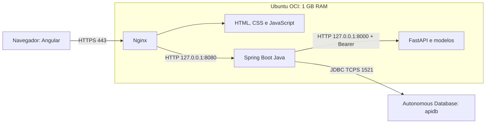

# Guia de estudos: DevOps, Infraestrutura e Arquitetura Cloud com TechMind

Base: implantação realizada em outubro de 2026. Este guia explica o ambiente entregue, apresenta comandos equivalentes para reproduzir as etapas e propõe exercícios. Não é uma transcrição integral do terminal. Comandos de instalação e provisionamento são para um ambiente de laboratório novo; não execute novamente os scripts de bootstrap na VM publicada.

## 1. Entenda o sistema antes de administrar

TechMind recebe conteúdos técnicos, solicita uma classificação a um modelo de machine learning e grava os resultados em Oracle. O Angular é a interface; o Java organiza as operações e a persistência; o Python executa a inferência.



Angular executa no navegador. Node.js foi utilizado para construir seus arquivos; não há servidor Node em produção. O Oracle está fora da VM, poupando sua memória. Nginx termina o HTTPS e encaminha as chamadas da API. As conexões HTTP internas percorrem o loopback da própria VM.

**Exercício:** explique o caminho de uma classificação desde o clique do usuário até a gravação no banco. Identifique em qual etapa você investigaria uma página em branco, um erro 401, um erro 502 e uma falha de persistência.

## 2. O que estudar para cada função

| Função | Responsabilidade neste projeto | Conceitos prioritários |
|---|---|---|
| DevOps | Produzir, entregar, configurar e verificar uma versão | Git, build, artefatos, dependências, configuração externa, CI/CD, testes, rollback |
| Analista de Infraestrutura | Manter VM, serviços, rede e capacidade funcionando | Linux, SSH, permissões, systemd, firewall, DNS, TLS, logs, RAM, disco e recuperação |
| Arquiteto Cloud | Decidir onde cada componente fica e justificar riscos e custos | VCN, subnets, rotas, exposição pública, serviços gerenciados, IAM, disponibilidade, escalabilidade e custo |

As funções se sobrepõem. DevOps também é uma prática de colaboração entre desenvolvimento e operação; não se resume a instalar ferramentas.

## 3. Infraestrutura real e escolhas de arquitetura

O usuário criou a VM, a VCN, a subnet e o Autonomous Database. A VM já tinha Java 21, Python 3.12, Nginx e swap de 2 GB quando a implantação foi continuada.

| Item | Ambiente entregue | Conceito |
|---|---|---|
| Compute | api-instance, VM.Standard.E2.1.Micro, Ubuntu 24.04, 1 GB | Máquina virtual e capacidade limitada |
| IP público | 140.238.236.255 | Endereço alcançável pela internet |
| IP privado | 10.0.0.168 | Endereço na VCN |
| Rede | vcn-api / subnet-public-api / rt-public-api | Segmentação e roteamento |
| Security List | sl-public-api; 22, 80 e 443 já liberados | Filtro de tráfego da OCI |
| Banco | apidb, Autonomous Database Always Free | Banco gerenciado fora da VM |
| Publicação | techmind.140-238-236-255.sslip.io | DNS temporário associado ao IP |

Uma subnet pública precisa de configuração de rota adequada e a VM precisa de IP público para o acesso usado aqui. Regras OCI e firewall Linux precisam permitir o mesmo fluxo. Abrir uma porta em um deles não abre automaticamente o outro.

**Decisão:** concentrar Nginx, Java e Python em uma VM reduz recursos necessários, mas cria um ponto único de falha. Um banco gerenciado reduz tarefas de administração do Oracle, mas não elimina a responsabilidade de definir recuperação e testar restauração. Não houve implementação de alta disponibilidade.

**Estude:** CIDR, IP privado/público, Internet Gateway, tabela de rotas, Security Lists, NSGs, regras com estado, IAM e menor privilégio. IAM controla operações na OCI; não substitui o usuário Linux ou a autenticação da aplicação.

## 4. SSH: como acessamos a instância

Execute no **PowerShell do Windows**:

```powershell
$vmKey = 'C:\Users\admin\.ssh\ssh-key-2026-10-02.key'
$vmTarget = 'ubuntu@140.238.236.255'
ssh -i $vmKey $vmTarget
```

`ssh` abre uma sessão criptografada; `-i` seleciona a chave privada; `ubuntu` é o usuário remoto. A chave pública correspondente fica autorizada na VM. A chave privada permanece no computador.

No primeiro acesso, confira a impressão digital do servidor por uma fonte confiável antes de aceitar. Não desative a verificação da identidade do servidor para contornar erros.

Para executar uma consulta sem abrir uma sessão interativa:

```powershell
ssh -i $vmKey -o BatchMode=yes -o ConnectTimeout=15 $vmTarget 'hostname; free -h; df -h /'
```

`BatchMode=yes` impede que uma automação fique esperando senha; `ConnectTimeout` limita o tempo inicial de conexão.

**Diagnóstico:** timeout normalmente pede investigação de rota, endereço, estado da VM ou firewall. `Permission denied (publickey)` pede conferência do usuário, da chave e da autorização SSH. São problemas em camadas diferentes.

## 5. Build: transformar código em artefatos

No **Windows**, dentro da raiz interna do projeto:

```powershell
Set-Location 'C:\Users\admin\OneDrive\Desktop\Github TechMind OCI\G9-BR-Team-04-main\G9-BR-Team-04-main'
Push-Location backend
.\mvnw.cmd clean package
Pop-Location
Push-Location frontend
npm ci
npm run build-prod
Pop-Location
```

Estes foram os comandos de compilação executados pelo usuário. O wrapper Maven define a ferramenta usada pelo projeto. `clean` remove o build anterior; `package` produz o JAR e executa as etapas de teste configuradas. `npm ci` instala a partir do lockfile; `build-prod` é um script do package.json.

Resultados utilizados:

- Java: `backend/target/techmind-0.0.1-SNAPSHOT.jar`.
- Angular: `frontend/dist/techmind-frontend/browser/`.
- Python: código, `requirements.txt` e modelos já treinados.

**Conceito:** build e execução são etapas distintas. Compilar fora da VM evita gastar a pouca RAM de produção com Maven e ferramentas Angular. O artefato deve permitir identificar qual versão está rodando. Nesta entrega não havia histórico Git disponível para associar o pacote a um commit.

## 6. Empacotamento: o que foi enviado

Foi criado `deploy/artifacts/techmind-oci.zip`, com esta organização:

```text
backend/techmind.jar
frontend/index.html e bundles
python/app/
python/requirements.txt
python/models/
```

Não foram enviados node_modules, venv ou segredos. Um venv Windows não deve ser copiado para Linux: os executáveis e algumas dependências dependem do sistema operacional.

Exemplo equivalente de montagem, no **PowerShell**, para um laboratório:

```powershell
$stagePath = Join-Path (Get-Location) 'deploy\lab-package'
New-Item -ItemType Directory -Force -Path "$stagePath\backend", "$stagePath\frontend", "$stagePath\python" | Out-Null
Copy-Item -LiteralPath 'backend\target\techmind-0.0.1-SNAPSHOT.jar' -Destination "$stagePath\backend\techmind.jar"
Copy-Item -Path 'frontend\dist\techmind-frontend\browser\*' -Destination "$stagePath\frontend" -Recurse
Copy-Item -LiteralPath 'api-python\app', 'api-python\models', 'api-python\requirements.txt' -Destination "$stagePath\python" -Recurse
Compress-Archive -Path "$stagePath\*" -DestinationPath 'deploy\techmind-lab.zip' -Force
Get-FileHash -LiteralPath 'deploy\techmind-lab.zip' -Algorithm SHA256
```

Use uma pasta de staging nova para cada versão; reaproveitar uma pasta sem limpeza pode incluir arquivos antigos. O exemplo usa um nome separado do pacote de produção.

## 7. SCP: como o arquivo local chegou à OCI

Foi usado **SCP sobre SSH**, do computador Windows para a VM. Não foi necessário bucket Object Storage.

Comandos equivalentes aos da transferência realizada, no **PowerShell**, após definir `$vmKey` e `$vmTarget`:

```powershell
scp -i $vmKey 'deploy\artifacts\techmind-oci.zip' "${vmTarget}:/home/ubuntu/techmind-oci.zip"
scp -i $vmKey 'deploy\legacy-single-vm\install-oci.sh' "${vmTarget}:/home/ubuntu/install-oci.sh"
scp -i $vmKey 'deploy\legacy-single-vm\publish-https.sh' "${vmTarget}:/home/ubuntu/publish-https.sh"
```

Leia o formato como `scp -i CHAVE ORIGEM USUARIO@IP:DESTINO`. Os dois-pontos separam o servidor do caminho remoto. As chaves em `${vmTarget}` evitam que o PowerShell interprete os dois-pontos como parte da sintaxe da variável.

Para copiar no sentido inverso, use a origem remota e um destino local:

```powershell
scp -i $vmKey "${vmTarget}:/opt/techmind/logs/techmind.log" '.\techmind.log'
```

Logs podem conter dados da aplicação; controle o acesso à cópia.

### Conferência de integridade

No Windows:

```powershell
Get-FileHash -LiteralPath 'deploy\artifacts\techmind-oci.zip' -Algorithm SHA256
```

Na VM:

```bash
sha256sum /home/ubuntu/techmind-oci.zip
```

Os valores foram comparados e coincidiram na implantação. SHA-256 detecta diferença nos bytes; não identifica sozinho o autor do pacote nem garante ausência de vulnerabilidades.

## 8. Instalação Linux e estrutura de diretórios

O script `install-oci.sh` extraiu o pacote em uma release com timestamp UTC e instalou os componentes. A release entregue foi `/opt/techmind/releases/20261003T024827Z`.

| Caminho | Finalidade |
|---|---|
| /opt/techmind/releases/ | Cópias dos artefatos por release |
| /opt/techmind/techmind.jar | JAR ativo |
| /opt/techmind/python/ | Código, modelos e venv Python |
| /opt/techmind/logs/ | Log Java |
| /etc/techmind/techmind.env | Configuração e segredos |
| /etc/systemd/system/ | Unidades dos serviços |
| /etc/nginx/sites-available/techmind | Configuração do proxy |

Trechos relevantes do instalador, para estudar:

```bash
sudo -u techmind python3.12 -m venv /opt/techmind/python/.venv
sudo -u techmind /opt/techmind/python/.venv/bin/python -m pip install \
  --no-cache-dir --only-binary=:all: \
  -r /opt/techmind/python/requirements.txt
```

`sudo -u` executa como o usuário da aplicação. O venv separa dependências Python do sistema. `--no-cache-dir` reduz arquivos de cache; `--only-binary=:all:` exige pacotes binários disponíveis, evitando compilação na VM. Se não existir wheel compatível, a instalação falha e deve ser investigada.

O script começa com `set -euo pipefail`: falha em variáveis não definidas e em diversas situações de erro, inclusive falha em pipelines. Isso ajuda a interromper uma instalação incompleta, mas não cria transação ou rollback automático.

**Atenção operacional:** o instalador substitui unidades e a configuração Nginx inicial. Não o execute novamente na VM publicada como se fosse um atualizador.

## 9. Permissões e segredos

Foi criado um usuário de serviço `techmind`. Java e Python não executam como root. O diretório de segredos tem modo 700 e o arquivo, 600, ambos de root.

```bash
sudo stat -c '%U %G %a %n' /etc/techmind /etc/techmind/techmind.env
```

`700` permite acesso somente ao proprietário do diretório; `600` permite leitura e escrita somente ao proprietário do arquivo. O gerenciador systemd lê o EnvironmentFile antes de iniciar o processo como techmind. O processo recebe os valores no ambiente; um administrador privilegiado ainda pode acessá-los.

Variáveis usadas: `DB_URL`, `DB_USERNAME`, `DB_PASSWORD`, `DB_DDL_AUTO`, `TECHMIND_API_KEY`, além dos limites de recursos. A chave foi gerada com `openssl rand -hex 32`. Não foi gravada no bundle Angular ou no repositório.

A senha ADMIN foi enviada temporariamente por SSH, com autorização, para provisionar o usuário TECHMIND. O arquivo temporário foi removido da VM. Não inclua senhas em comandos publicados, screenshots ou logs de CI.

**Estude:** gestão de segredos, rotação, OCI Vault e privilégio mínimo. A solução entregue usa arquivo protegido, sem Vault ou rotação automática. A chave compartilhada do site não oferece identidade individual ou permissões por usuário.

## 10. Banco: conectividade, TLS e esquema

O banco inicialmente exigia mTLS; a descrição recebida usava porta 1522. A tentativa JDBC retornou ORA-12506. Depois de conferir o console e obter confirmação, a ACL foi limitada a `140.238.236.255` e TLS sem certificado de cliente foi habilitado. Foi utilizada a descrição TLS do serviço `_low`, na porta 1521.

TLS valida o certificado do servidor e criptografa o canal. mTLS também exige identidade por certificado do cliente. Não remova mTLS em outro ambiente sem avaliar sua política de acesso e a configuração de rede.

O endpoint permanece público, restrito pela ACL. As portas e descrições de conexão devem vir do console do banco correspondente; não deduza o descriptor de outro banco.

`DbProvision.java` usou ADMIN para criar ou alterar TECHMIND, gerar senha aleatória e conceder:

```sql
GRANT CREATE SESSION, CREATE TABLE, CREATE SEQUENCE TO TECHMIND;
ALTER USER TECHMIND QUOTA 100M ON DATA;
```

`CREATE SESSION` permite conexão; os demais privilégios permitem criar o esquema; a quota limita o espaço atribuído no tablespace. A aplicação usa TECHMIND, não ADMIN.

Na primeira inicialização foi usado `DB_DDL_AUTO=update`; depois, `validate`. `update` pode alterar estruturas automaticamente; `validate` confere a compatibilidade sem fazer essa atualização. Não foram implantadas migrações versionadas.

**Exercício em laboratório:** desenhe uma evolução usando Flyway ou Liquibase e usuários distintos para migração e execução. O helper existente rotaciona a senha ao ser executado novamente; não o use como teste de saúde.

## 11. systemd: manter a aplicação executando

Serviços: `techmind-python.service` e `techmind-backend.service`. Foram configurados para reiniciar em falhas e iniciar com o sistema.

Comandos de **consulta**, seguros para estudar na VM:

```bash
systemctl is-active techmind-python techmind-backend nginx
systemctl is-enabled techmind-python techmind-backend nginx
systemctl status techmind-backend --no-pager
systemctl cat techmind-backend
sudo journalctl -u techmind-backend -n 100 --no-pager
sudo journalctl -u techmind-python -n 100 --no-pager
```

Comandos de **alteração**, use em laboratório ou manutenção planejada:

```bash
sudo systemctl daemon-reload
sudo systemctl enable techmind-backend
sudo systemctl restart techmind-backend
```

`daemon-reload` relê unidades, não reinicia o programa. `enable` configura início no boot; `start` inicia agora; `restart` interrompe e inicia novamente. Um serviço ativo pode estar incapaz de atender corretamente: também verifique o health check.

O backend tem `After` e `Wants` para o Python. Isso organiza início e dependências, mas não garante que o modelo já terminou de carregar.

Hardening aplicado: `NoNewPrivileges=true`, `PrivateTmp=true`, `ProtectHome=true`, `ProtectSystem=full`. Estude o alcance de cada opção; elas não isolam integralmente os processos como uma VM independente.

## 12. Capacidade: como coube em 1 GB

Java foi iniciado com:

```text
-Xms64m -Xmx256m -XX:+UseSerialGC
-XX:MaxMetaspaceSize=160m -XX:ReservedCodeCacheSize=64m
-XX:MaxDirectMemorySize=32m -XX:+ExitOnOutOfMemoryError
```

Heap guarda objetos Java; metaspace guarda metadados de classes; code cache guarda código compilado pela JVM. Também existem memória nativa e stacks. `-Xmx256m` não limita o processo inteiro a 256 MB.

Python usa um worker Uvicorn, limite de concorrência 4 e `OPENBLAS_NUM_THREADS=1`, `OMP_NUM_THREADS=1`, `MKL_NUM_THREADS=1`. Mais workers podem duplicar a memória dos modelos. O backend tem pool Oracle de duas conexões e bulkhead de uma chamada simultânea ao classificador.

Estude a diferença entre:

- **Pool:** reutiliza e limita conexões ao banco.
- **Bulkhead:** limita simultaneidade para proteger recursos.
- **Timeout:** limita quanto uma operação pode esperar.
- **Retry:** repete algumas falhas; pode aumentar carga e duplicar efeitos sem idempotência.
- **Circuit breaker:** interrompe temporariamente chamadas a uma dependência que está falhando.

Comandos de observação:

```bash
free -h
swapon --show
df -h /
ps -eo pid,user,rss,%cpu,comm --sort=-rss | head -n 15
vmstat 1 5
```

RSS é memória residente, geralmente exibida em KiB nesse ps. Em `vmstat`, observe `si/so` para movimentação de swap. Swap permite descarregar páginas para disco, mas pode elevar muito a latência.

Na auditoria havia aproximadamente 703 MiB usados, 250 MiB disponíveis e 166 MiB de swap usados. Não houve teste de carga; estes números não estabelecem capacidade para determinado número de usuários.

## 13. Nginx, mesma origem e rotas Angular

O frontend usa URLs relativas. Assim, navegador e API usam o mesmo domínio HTTPS, e Nginx encaminha `/conteudo` e `/users` ao Java.

Trechos da configuração entregue:

```nginx
location ~ ^/(conteudo|users)(/|$) {
    proxy_pass http://127.0.0.1:8080;
    proxy_set_header Host $host;
    proxy_set_header X-Real-IP $remote_addr;
    proxy_set_header X-Forwarded-For $proxy_add_x_forwarded_for;
    proxy_set_header X-Forwarded-Proto $scheme;
    proxy_read_timeout 120s;
}
location / {
    try_files $uri $uri/ /index.html;
}
```

`try_files` permite atualizar uma rota Angular como `/articles-list`: se não existir arquivo correspondente, entrega index.html. Isso também significa que um 200 em um caminho desconhecido pode ser HTML, não uma resposta da API.

O timeout Nginx de 120 segundos não anula o timeout menor do cliente Java. O limite de upload é 2 MB, mas multipart possui overhead.

Diagnóstico e alteração controlada:

```bash
sudo nginx -t
sudo nginx -T
sudo tail -n 50 /var/log/nginx/error.log
# Após revisar uma alteração válida:
sudo systemctl reload nginx
```

Na implantação houve conflito de socket durante uma troca de bind. Um reload não aplicou a nova configuração; o log apontou a falha e um restart resolveu. Reload normalmente busca aplicar configuração sem interrupção ampla; restart fecha e reabre os processos, podendo interromper requisições.

## 14. DNS, HTTPS e renovação

O hostname gratuito resolve para o IP da VM. Não foi criada zona DNS própria. Se o IP mudar, o hostname atual deixa de apontar para a nova VM.

Let's Encrypt emitiu o certificado com Certbot e desafio HTTP-01/webroot. O serviço de validação acessa um arquivo em `/.well-known/acme-challenge/` pela porta 80. Nginx deixa esse caminho acessível e redireciona os demais pedidos HTTP para HTTPS.

Comando utilizado na emissão inicial, registrado para estudo:

```bash
sudo certbot certonly --webroot -w /var/www/letsencrypt \
  -d techmind.140-238-236-255.sslip.io \
  --non-interactive --agree-tos --register-unsafely-without-email
```

A emissão não cadastrou e-mail. Em um laboratório novo, você pode configurar um e-mail operacional. Não repita emissões desnecessariamente.

Consultas:

```bash
systemctl status certbot.timer --no-pager
sudo certbot certificates
```

Teste de renovação usado e aprovado na implantação:

```bash
sudo certbot renew --dry-run
```

Há um deploy hook para recarregar Nginx após renovação. Estude certificado, chave privada, cadeia de confiança, nome do servidor, expiração e renovação. Um certificado válido não substitui autenticação ou autorização da aplicação.

## 15. Rede: confirme quem escuta e quem pode entrar

```bash
sudo ss -lntp
sudo iptables -L INPUT -n -v --line-numbers
```

Expectativa: Nginx público em 80/443; Java em `127.0.0.1:8080`; Python em `127.0.0.1:8000`. `127.0.0.1` só aceita tráfego local; `0.0.0.0` representa todas as interfaces IPv4.

Na implantação foram permitidas 80/443 no iptables antes da regra de rejeição, e as regras foram persistidas em `/etc/iptables/rules.v4`. As regras OCI existentes já permitiam essas portas.

**Melhoria pendente:** SSH 22 na OCI continua liberado para qualquer origem. Restrinja às origens administrativas ou adote acesso controlado, preservando uma forma de recuperação antes de alterar regras.

## 16. Alterações no código que facilitaram a operação

| Adaptação | Por que importa para implantação |
|---|---|
| Banco, endpoints e chave por variáveis | Permite mudar ambiente sem recompilar |
| Java e Python escutam em loopback | Reduz exposição direta |
| Bearer obrigatório nos endpoints protegidos | Bloqueia chamadas sem chave |
| Health checks locais | Ajuda a separar processo ativo de aplicação pronta |
| Cliente Java com timeouts e chave | Define comunicação e espera entre serviços |
| Angular com URLs relativas e interceptor | Integra com o proxy na mesma origem |
| PBKDF2 para senhas cadastradas | Evita persistência de senha em texto simples; não cria login individual |
| OpenAPI desabilitado por padrão | Reduz exposição desnecessária |
| Dependências revisadas e wrapper Windows corrigido | Ajuda a construir e executar o projeto |
| Download opcional de modelos com HTTPS/hash/limite | Controla integridade e tamanho; pickle desconhecido permanece perigoso |

A VM usa modelos locais do projeto. Não houve treinamento novo nem integração Object Storage nessa instalação. A chave do navegador fica em sessionStorage e é compartilhada; autenticação individual e autorização continuam como evolução.

## 17. Validação: siga as camadas

Na **VM**, consulte serviços internos:

```bash
curl --fail --silent --show-error http://127.0.0.1:8000/health
curl --fail --silent --show-error http://127.0.0.1:8080/actuator/health
```

No **Windows**, consulte a publicação:

```powershell
Resolve-DnsName 'techmind.140-238-236-255.sslip.io'
Test-NetConnection '140.238.236.255' -Port 443
curl.exe -I 'https://techmind.140-238-236-255.sslip.io/'
curl.exe -I 'http://techmind.140-238-236-255.sslip.io/'
curl.exe -i 'https://techmind.140-238-236-255.sslip.io/conteudo/titulo'
```

A última chamada é intencionalmente sem chave: espera-se 401. Os health checks não são publicados pelo proxy configurado; `/actuator/health` público pode retornar o HTML Angular.

Resultados históricos: Python saudável e classificação 200; Java UP; API sem chave 401; criação de conteúdo 201 com persistência; consulta 200; site HTTPS 200; redirecionamento HTTP; dry-run do Certbot bem-sucedido. Um registro de teste ID 1 ficou no banco.

Não foram feitos teste de carga, teste completo de todas as telas, restauração de backup ou reboot controlado. Esses testes são etapas futuras, não resultados já obtidos.

## 18. Troubleshooting: pense em hipóteses verificáveis

| Sintoma | Investigue primeiro | Evidência útil |
|---|---|---|
| SSH não conecta | IP, estado VM, rota e regras 22 | Test-NetConnection e console OCI |
| HTML abre, API 502 | Java parado ou upstream incorreto | journalctl, ss e error.log Nginx |
| API 401 | Chave ausente/incorreta | Status HTTP e interceptor; não imprima a chave |
| Classificação falha | Python, modelo, timeout, concorrência | Health Python e logs dos dois serviços |
| Banco rejeita | Descriptor, ACL, modo TLS, usuário | Código Oracle e configuração do console |
| Rota Angular 404 | Fallback SPA | try_files e root Nginx |
| Site lento | RAM/swap/CPU/banco | vmstat, ps, logs e tempos de resposta |
| Disco cheio | Logs, releases e caches | df e du nos diretórios relevantes |
| Certificado não renova | DNS, porta 80, desafio e timer | Certbot e logs Nginx |

Use uma alteração por hipótese quando possível e confira o resultado. Não troque senhas ou abra todas as portas como primeiro passo de diagnóstico.

## 19. Como evoluir para uma operação profissional

Estas melhorias não foram implantadas:

1. Git com histórico e versão associada ao commit.
2. CI: build, testes relevantes, análise de dependências e publicação do artefato.
3. CD: transferência do artefato já construído, configuração preservada, verificação de saúde e promoção da release.
4. Rollback: release completa e ponteiro para a versão ativa; compatibilidade do esquema deve ser considerada separadamente.
5. Infraestrutura como código: Terraform para recursos OCI; Ansible ou equivalente para configuração do sistema.
6. Migrações SQL versionadas e identidade distinta para execução.
7. Monitoramento: disponibilidade, latência, erros, RAM/swap, disco e expiração de certificado, com alertas acionáveis.
8. Recuperação: definir RPO (perda de dados aceitável) e RTO (tempo de recuperação), depois testar restauração.
9. Acesso: SSH restrito, autenticação individual, autorização, gestão e rotação de segredos.
10. Capacidade e custos: carga controlada, critérios para escalar e conferência de elegibilidade/preços antes de criar recursos.

O processo atual é deployment manual apoiado por scripts. Não há CI/CD, Terraform, Docker, Kubernetes ou rollback automático. O histórico de releases não basta para rollback: o JAR e o Python ativos estão em caminhos mutáveis, e o banco pode ter mudado.

## 20. Plano de estudo de seis semanas

| Semana | Tema | Entrega prática |
|---|---|---|
| 1 | Linux, SSH e permissões | Acessar um laboratório, consultar serviços, explicar 600/700 e copiar arquivo por SCP |
| 2 | Build e artefatos | Construir Java/Angular, montar ZIP sem segredos, conferir SHA-256 remoto |
| 3 | systemd e capacidade | Criar serviço de laboratório, observar falha/reinício, medir RAM e swap |
| 4 | Rede, Nginx, DNS e TLS | Desenhar fluxos e portas; publicar uma SPA/API de laboratório com HTTPS |
| 5 | Banco, segurança e recuperação | Criar migração versionada; separar credenciais; documentar restauração |
| 6 | CI/CD e arquitetura | Pipeline em ambiente de teste, rollback demonstrado e proposta de evolução com custos |

Para cada exercício, registre: objetivo, comando, resultado esperado, resultado observado e conclusão. Use ambiente separado para falhas intencionais, mudanças de esquema e reinícios.

## 21. Perguntas para entrevista e autoavaliação

1. Por que o Angular não precisa de Node rodando na VM?
2. Qual a diferença entre Security List, firewall Linux e bind em loopback?
3. Como SCP usa a chave SSH sem copiar a chave privada para a VM?
4. Por que compilamos localmente em vez de na VM de 1 GB?
5. O que um hash igual prova e o que não prova?
6. Por que systemd ativo não garante uma API saudável?
7. Por que Xmx não representa toda a memória Java?
8. Qual a diferença entre TLS e mTLS, e qual o papel da ACL?
9. Por que validate é diferente de update no Hibernate?
10. Como reverter uma versão se houve alteração incompatível no banco?
11. O que muda se o IP público da VM mudar?
12. Como detectar uma aplicação lenta antes de o usuário reclamar?
13. Qual é o ponto único de falha desta arquitetura?
14. Como provar que um backup atende ao RPO e ao RTO?

## 22. Arquivos reais para estudar junto com o guia

- `deploy/docs/RELATORIO_IMPLANTACAO_OCI.md`: registro detalhado do que foi feito e verificado.
- `deploy/legacy-single-vm/install-oci.sh`: instalação inicial, permissões, Python, systemd e Nginx.
- `deploy/legacy-single-vm/publish-https.sh`: firewall, desafio ACME, certificado e HTTPS.
- `deploy/database/DbProvision.java`: provisionamento do usuário e configuração do banco; rotaciona senha.
- `deploy/checks/check-python.py` e `deploy/checks/check-backend.py`: verificações internas; a verificação do backend pode gravar conteúdo de teste.
- `backend/src/main/resources/application.properties`: parâmetros, pool e resiliência.
- `frontend/src/app/core/auth.interceptor.ts`: envio da chave pela interface.
- `api-python/app/main.py`: API do classificador e autenticação.

Comece lendo cada arquivo e relacionando cada linha de configuração a uma etapa do diagrama. Ao terminar, você deve conseguir explicar a implantação, reproduzi-la em laboratório e diagnosticar uma falha sem depender de tentativa e erro.
