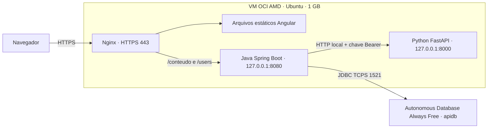

# Relatório técnico da implantação TechMind

Site: https://techmind.140-238-236-255.sslip.io

Este documento registra as ações realizadas na conversa e a configuração conferida na VM. A pasta recebida não contém histórico Git, portanto não foi possível gerar um diff entre uma versão original e a atual. As alterações de preparação do projeto ocorreram antes da compilação executada pelo usuário; a implantação posterior usou esses artefatos compilados.

## Arquitetura resultante

Angular executa no navegador. O servidor distribui HTML, CSS e JavaScript; não executa um servidor Node.js em produção. Java atende a API, valida os dados e persiste no Oracle. Python carrega os modelos existentes e calcula as classificações. O banco fica fora da VM, sem consumir sua memória.

Essa instalação utiliza processos Linux gerenciados por systemd. Não usa Docker, Kubernetes, balanceador de carga ou OCI API Gateway. Há uma instância do backend e um processo do classificador; ambos dependem da mesma VM.

## Infraestrutura reaproveitada

A VM, o banco, a VCN, a subnet e as regras de rede foram criados pelo usuário. Ao conectar, já encontrei Ubuntu 24.04, Java 21, Python 3.12, Nginx e uma swap de 2 GB. Não criei novamente esses recursos.

- Instância api-instance: VM.Standard.E2.1.Micro, AMD, 1 GB.
- IP público: 140.238.236.255; IP privado: 10.0.0.168.
- VCN: vcn-api; subnet pública: subnet-public-api; tabela de rotas: rt-public-api.
- Security List: sl-public-api.
- Na conferência, a Security List já permitia TCP 22, 80 e 443 de 0.0.0.0/0. Essas regras da OCI foram reaproveitadas.
- O filesystem raiz tem aproximadamente 45 GiB utilizáveis e usava cerca de 5,8 GiB na auditoria.
- A swap preexistente foi mantida.

No firewall do Ubuntu, inseri uma permissão apenas para TCP 80 e 443, antes da regra que rejeita novas conexões. Preservei as demais regras e salvei em /etc/iptables/rules.v4. O serviço netfilter-persistent está habilitado.

SSH continua na configuração preexistente, com chave privada. Sua regra OCI permite qualquer origem; não configurei restrição ao IP do administrador.

## Banco de dados

O banco é o Autonomous Database Always Free apidb, em São Paulo. Primeiro testei a rede e a conexão JDBC. O banco rejeitou a conexão com ORA-12506, antes de validar a senha. No console, confirmei ACL desabilitada e mTLS obrigatório.

Após confirmação explícita do usuário, salvei a ACL permitindo somente o IP 140.238.236.255 e removi a exigência de mTLS. O banco continua aceitando conexão criptografada com validação do certificado do servidor e autenticação por usuário/senha. mTLS permanece disponível, mas não obrigatório. Foi usado o serviço _low, com TCPS na porta 1521.

A conexão usa jdbc:oracle:thin:@ seguido da descrição TLS; ela não usa o endereço local FREEPDB1 nem uma wallet. O endpoint do banco é público, protegido pela ACL; não configurei um private endpoint.

Enviei temporariamente a senha ADMIN, com autorização específica, diretamente por SSH para um arquivo root com acesso restrito. Usei ADMIN para configurar TECHMIND, gerei uma nova senha aleatória para a aplicação e depois removi o arquivo temporário da VM. O arquivo original de senha na área de trabalho do usuário permaneceu local.

Privilégios concedidos a TECHMIND: CREATE SESSION, CREATE TABLE e CREATE SEQUENCE; quota de 100 MB no tablespace DATA. A aplicação não usa ADMIN. Os privilégios de criação de tabelas e sequências continuam concedidos; não fiz uma separação entre usuário de migração e usuário de execução.

Na primeira inicialização, usei DB_DDL_AUTO=update para criar o esquema. Após conferir o backend, alterei para validate e reiniciei. A inicialização posterior passou. Não foi implantado Flyway ou Liquibase; futuras mudanças de esquema precisam de migrações revisadas e backup.

## Compilação, pacote e transferência

O usuário executou Maven clean package e npm ci/build-prod no Windows. Confirmei a existência do JAR e do index.html de produção.

Montei deploy/artifacts/techmind-oci.zip com o JAR, o frontend compilado, os módulos Python, requirements.txt e os modelos pickle. Não incluí node_modules, ambientes virtuais ou segredos. O SHA-256 foi comparado localmente e na VM, com correspondência. Esse hash confere integridade da transferência; não é uma assinatura criptográfica da versão.

Enviei o pacote e os scripts usando SCP com a chave SSH indicada pelo usuário. Os arquivos foram extraídos em uma pasta de release com timestamp UTC em /opt/techmind/releases. O JAR ativo fica em /opt/techmind/techmind.jar e o Python em /opt/techmind/python. O Nginx aponta para o frontend da pasta de release.

Instalei as dependências Python em um venv com --no-cache-dir e --only-binary=:all:, para reduzir armazenamento temporário e evitar compilação de dependências nativas na VM pequena. Os modelos já treinados foram copiados; não treinei novamente o modelo e não configurei Object Storage para essa instalação.

O processo é manual e usa scripts locais. Não criei pipeline CI/CD, GitHub Actions, Terraform, Ansible ou um registro de artefatos. As pastas de release preservam uma cópia dos artefatos, mas não há promoção atômica, teste automático de rollback ou reversão automatizada.

## Serviços systemd

Criei techmind-python.service e techmind-backend.service e os habilitei para iniciar com a VM. Os processos executam como usuário Linux techmind, sem privilégios root. systemd lê o arquivo de ambiente protegido antes de iniciar os processos.

Ambos usam Restart=on-failure; Python espera 10 segundos e Java 15 segundos antes da tentativa de reinício. O backend declara ordenação após rede e serviço Python. Essa ordenação não garante que o modelo já esteja pronto; a disponibilidade foi conferida por health check.

Proteções: NoNewPrivileges=true, PrivateTmp=true, ProtectHome=true e ProtectSystem=full. Isso reduz acessos e impede ganho de privilégios, mas não torna a aplicação totalmente isolada: /opt e /var não são integralmente somente leitura com essas opções.

A aplicação gera logs no journal; o backend também usa /opt/techmind/logs/techmind.log. Não implantei coleta centralizada de logs ou alertas externos.

## Ajustes para 1 GB

JVM: -Xms64m -Xmx256m, SerialGC, metaspace máximo 160 MB, code cache 64 MB, memória direta 32 MB e ExitOnOutOfMemoryError. O heap é apenas parte da memória do processo; -Xmx256m não significa que o Java consuma no máximo 256 MB no total.

Python: um worker Uvicorn, --limit-concurrency 4 e uma thread nas bibliotecas numéricas via OPENBLAS_NUM_THREADS, OMP_NUM_THREADS e MKL_NUM_THREADS. Esse limite Uvicorn considera conexões/tarefas; não deve ser interpretado como garantia de quatro classificações simultâneas.

Backend: no ambiente de produção, o pool Hikari foi limitado a duas conexões, com mínimo ocioso de uma; o bulkhead do classificador foi limitado a uma chamada simultânea. As configurações gerais do código são sobrescritas pelas variáveis da VM.

Na auditoria, havia aproximadamente 703 MiB usados, 250 MiB disponíveis e 166 MiB de swap usados. A soma não é simplesmente RAM livre: o Linux também mantém cache reutilizável. A última inicialização registrada levou cerca de 135 segundos, durante a preparação da VM. Isso mostra que inicialização pode ser lenta nessa configuração, sem estabelecer uma meta de desempenho.

Não executei teste de carga ou teste de saturação. Swap não substitui RAM; os resultados obtidos comprovam funcionamento nas requisições testadas, não capacidade para muitos usuários.

## Nginx, DNS e HTTPS

Configurei Nginx para servir o frontend, encaminhar /conteudo e /users ao Java e retornar index.html para rotas Angular. Isso permite abrir e atualizar diretamente URLs como /articles-list.

O Nginx repassa Host, X-Real-IP, X-Forwarded-For e X-Forwarded-Proto. Configura timeout de leitura de 120 segundos e limite de upload de 2 MB. No backend, o limite também é 2 MB; multipart inclui overhead, portanto o limite não deve ser apresentado como garantia de aceitar qualquer CSV de exatamente 2 MB.

Corrigi um conflito de socket durante a troca da configuração inicial: o reload deixou a configuração antiga ativa porque a nova escuta local não conseguiu abrir a porta. Validei a sintaxe e reiniciei o Nginx; a API então passou pelos testes. O instalador foi atualizado para usar restart nessa etapa inicial.

O endereço gratuito techmind.140-238-236-255.sslip.io resolve para o IP público sem compra de domínio. Ele depende de um serviço DNS externo e do IP atual da VM. Não foi configurado domínio próprio ou DNS Zone na OCI.

Instalei Certbot dos pacotes Ubuntu, emiti certificado Let's Encrypt e ativei certbot.timer. A validação usa HTTP-01/webroot em /var/www/letsencrypt. HTTP redireciona para HTTPS, exceto o caminho de validação ACME. O certificado suporta TLS 1.2/1.3; a configuração mantém a validação normal no cliente.

Criei um deploy hook que recarrega o Nginx após renovação. certbot renew --dry-run passou. O certificado emitido expira em 1º de janeiro de 2027, com renovação automática configurada. Não cadastrei e-mail nessa emissão, portanto não há notificação por e-mail configurada para a conta ACME.

Headers adicionados: X-Content-Type-Options: nosniff e Referrer-Policy: strict-origin-when-cross-origin. Não configurei WAF, limite de requisições por IP ou um conjunto completo de headers como CSP/HSTS.

## Configuração e segredos

Segredos ficam em /etc/techmind/techmind.env. O diretório pertence a root, modo 700; o arquivo pertence a root, modo 600. A senha da aplicação e a chave não foram inseridas no frontend compilado ou no repositório.

A chave da aplicação foi gerada com openssl rand -hex 32. Ela é usada no Java, Python e frontend. A senha de TECHMIND foi gerada com SecureRandom. Copiei a chave para a área de transferência local para o usuário acessar o site, sem mostrá-la em logs ou no chat.

Essa é gestão de segredos em arquivo local, não uso de OCI Vault, identidade de instância ou rotação automática. Um administrador root da VM pode ler os segredos.

## Alterações no código para preparar a implantação

Estas adaptações já estavam no build usado na implantação:

- Backend parametrizado por DB_URL, DB_USERNAME, DB_PASSWORD, DB_DDL_AUTO, SERVER_ADDRESS, CLASSIFIER_BASE_URL e TECHMIND_API_KEY.
- Padrão de escuta em 127.0.0.1; credenciais e chave obrigatórias; chave com pelo menos 32 caracteres.
- Filtro Java exige Authorization: Bearer, retornando 401 para chamadas sem chave; comparação com MessageDigest.isEqual. Health permanece disponível localmente.
- Cliente Java envia a chave ao Python, usa HTTP/1.1, timeout de conexão de 3 segundos e de leitura de 10 segundos.
- Python exige chave Bearer, usa compare_digest e expõe /health com indicador de modelo carregado.
- Frontend usa URLs relativas, compatíveis com o proxy Nginx na mesma origem, e um interceptor adiciona a chave a /conteudo e /users. A chave fica em sessionStorage e é solicitada por um prompt.
- OpenAPI desabilitado por padrão e amostragem de tracing zerada por padrão, sem infraestrutura de tracing externa na instalação.
- Proteção de senhas de usuários com PBKDF2, salt aleatório e coluna compatível com o hash; isso não implementa login individual.
- Atualização de dependências Java/Python e correção do wrapper Maven Windows durante a revisão anterior. Não foi feita, nesta etapa de implantação, uma nova auditoria completa de vulnerabilidades.
- Modelos remotos, quando configurados, exigem URL HTTPS e SHA-256, com limite de download e timeout. Nesta VM foram usados os modelos locais confiáveis do projeto. A verificação de hash não torna pickle de origem desconhecida seguro.

Durante a implantação não reescrevi a lógica de classificação nem recriei o frontend. Configurei processos, ambiente, proxy, banco e TLS. Adicionei os scripts de instalação/publicação, os auxiliares JDBC, as verificações e os documentos. Atualizei .gitignore para excluir classes compiladas, pacote ZIP, staging e capturas, além dos diretórios de build já excluídos.

## Testes executados

- Integridade do pacote por SHA-256.
- Python health com modelo_carregado=true e classificação direta HTTP 200.
- Backend health UP e inicialização com validate.
- API sem chave: HTTP 401.
- Classificação via Java, chamada Python e persistência Oracle: HTTP 201.
- Consulta do conteúdo salvo: HTTP 200.
- Verificação repetida pela URL HTTPS pública; certificado validado normalmente pelo cliente.
- Página Angular pública: HTTP 200, com app-root presente.
- Redirecionamento HTTP→HTTPS.
- Serviços ativos e habilitados; renovação do certificado simulada com sucesso.

Foi mantido no banco o registro de teste de implantação ID 1. A aplicação ficou disponível para acesso manual no navegador com a chave. Não fiz um teste completo de todas as telas, carga de CSV no limite, recuperação de backup ou reboot controlado da VM. Configurar os serviços para iniciar após reboot não equivale a ter testado esse reboot.

## Limitações e próximas melhorias

Para amadurecer a operação: versionar o projeto em Git; criar CI/CD com artefatos identificados; separar bootstrap de atualização; implantar migrações; preparar rollback e testar restauração; adicionar monitoramento e alertas; restringir SSH às origens administrativas; adotar autenticação individual/autorização; testar carga e revisar uso de memória; usar domínio próprio/IP reservado quando apropriado.

Não configurei alta disponibilidade ou política própria de backup. O Autonomous Database tem recursos gerenciados, mas não implementei ou testei uma estratégia de recuperação da aplicação. Não configurei controles próprios de orçamento ou garantia de cobrança zero; a implantação utiliza recursos identificados como Always Free no console.

Os scripts de bootstrap não devem ser executados indiscriminadamente em produção: o instalador inicial pode substituir configurações e o configurador JDBC gera uma nova senha para TECHMIND quando executado. Uma atualização normal precisa preservar os segredos, o HTTPS e o esquema existente.
